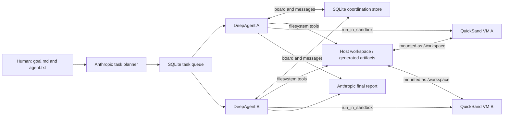

# agents_swarm — DeepAgents collaborative coding team

A standalone prototype for a small group of agents that share a task queue, persistent messages, and a context board. Each task runs in a Microsoft QuickSand Ubuntu VM. Replace `agent.txt` with your project-specific workflow when ready.

## Collaboration model

- Multiple agent workers can run concurrently in one process.
- A SQLite transaction gives each task to at most one worker; claiming automatically writes a `CLAIM` board entry.
- Agents read/write files in the configured workspace, run commands in their QuickSand VM, inspect shared board/messages, and message peers or `team`.
- Tasks, messages, and board entries persist in `.team/team.sqlite3` by default.
- DeepAgents provides the coding-agent loop and filesystem tools. LangChain with Anthropic creates the subtask plan and final report.

DeepAgents' `FilesystemBackend` reads and writes the host workspace directly. QuickSand separately mounts that same host folder into each VM, where the `run_in_sandbox` tool executes code and tests. QuickSand runs a real QEMU virtual machine, not a container. The shared workspace is writable from both host and guest by design. Guest networking is restricted to `MOUNTS_ONLY`, and agents do not receive a host-shell tool. Review changes before using them.

## Configuration

- `TEAM_MODEL`: Anthropic model name; defaults to `claude-sonnet-4-5`.
- `ANTHROPIC_BASE_URL`: optional Anthropic-compatible endpoint override.
- `TEAM_HOME`: persistent coordination database directory; defaults to `.team`.
- `TEAM_WORKSPACE`: host directory for generated code, tests, and other task artifacts; defaults to `./workspace`.
- `TEAM_INSTRUCTIONS`: instructions file; defaults to `agent.txt`.

Set `ANTHROPIC_API_KEY` in `.env` (copy `.env.example`) or the shell. Install the project in a Python 3.11+ environment with `pip install -e .`; dependencies include `quick-sandbox[qemu,ubuntu]`. QuickSand may need initial VM/runtime setup on first use; macOS runs the guest using the supported host virtualization runtime.

## Project layout and data

```text
agents_swarm/
  agent.py                 # Claim and run one task with DeepAgents
  cli.py                   # CLI and concurrent worker launcher
  projects.py              # Brief decomposition, swarm run, and final report
  coordination/
    board.py               # Shared board and peer-message tools
    tasks.py               # Complete/block current-task tools
  execution/
    quicksand.py           # Host workspace mount and sandbox command tool
  storage/
    store.py               # SQLite persistence and atomic task claims
tests/
  test_store.py
examples/
  portfolio_exposure/      # End-to-end goal, instructions, and synthetic holdings
.team/
  team.sqlite3             # Coordination state, created at runtime
workspace/                  # Generated code and tests, created at runtime
agent.txt                   # Editable agent instructions
```

`TEAM_HOME` controls the SQLite database location. `TEAM_WORKSPACE` is the host-side artifact folder; QuickSand maps it read/write to `/workspace` inside each VM. A file written by an agent under `TEAM_WORKSPACE/src/` appears in the guest at `/workspace/src/`; a test or build artifact written there remains on the host after the VM stops. Keep the database and workspace separate. The default `workspace/` and `.team/` directories are Git-ignored.

Each worker gets its own VM but mounts the same host workspace, so use non-overlapping task areas where practical. The guest uses `NetworkMode.MOUNTS_ONLY`; commands that download packages may fail unless you intentionally change the network policy. VM isolation is not a substitute for protecting secrets in the mounted workspace or reviewing the resulting code.

## Use

For a large goal, save the whole request as a text or Markdown file, for example `goal.md`, then run:

```text
agents-swarm run-file goal.md --agents agent-1,agent-2,agent-3
```

This single command asks the planner to break the brief into focused, non-overlapping tasks; stores the brief and plan in SQLite; starts the agents to claim and execute those tasks; and synthesizes a final report. The report is printed and saved under `workspace/reports/project-<id>-final.md`. Generated code and tests go in `workspace/` by default. If some tasks fail or are blocked, the report marks the project incomplete instead of claiming success.

See the [portfolio exposure example](examples/portfolio_exposure/README.md) for a complete goal brief and synthetic CSV fixture.

For a small, manually defined task, add it directly:

```text
agents-swarm add-task "Inspect the authentication flow" "Document the API surface"
```

Run workers concurrently; each keeps claiming tasks until the queue is empty:

```text
agents-swarm work --agents analyst-1,analyst-2
```

Have each worker do at most one task, or keep polling for new tasks:

```text
agents-swarm work --agents analyst-1,analyst-2 --once
agents-swarm work --agents analyst-1,analyst-2 --watch
```

Inspect state or post context/messages:

```text
agents-swarm status
agents-swarm note FACT "Confirmed the endpoint returns paginated results" --agent human
agents-swarm message analyst-1 "Please check the edge cases" --from-agent human
```

Alternatively run `python -m agents_swarm`. Commands should be run from this directory so `.env` is loaded from the current working directory.

## Architecture



## Current limitations

- Agents can execute commands and tests only inside QuickSand VMs; there is no host-shell execution.
- Git branches, pull requests, and automatic merges are not implemented; review and integrate code yourself.
- Task claims do not expire automatically if a process is killed. Check `status` and recover stuck tasks manually.
- Board/messages are durable logs, not real-time interrupts. Agents see peer updates when they call `board_read`.
- Replace `agent.txt` to define domain, success criteria, project conventions, and review policy.
